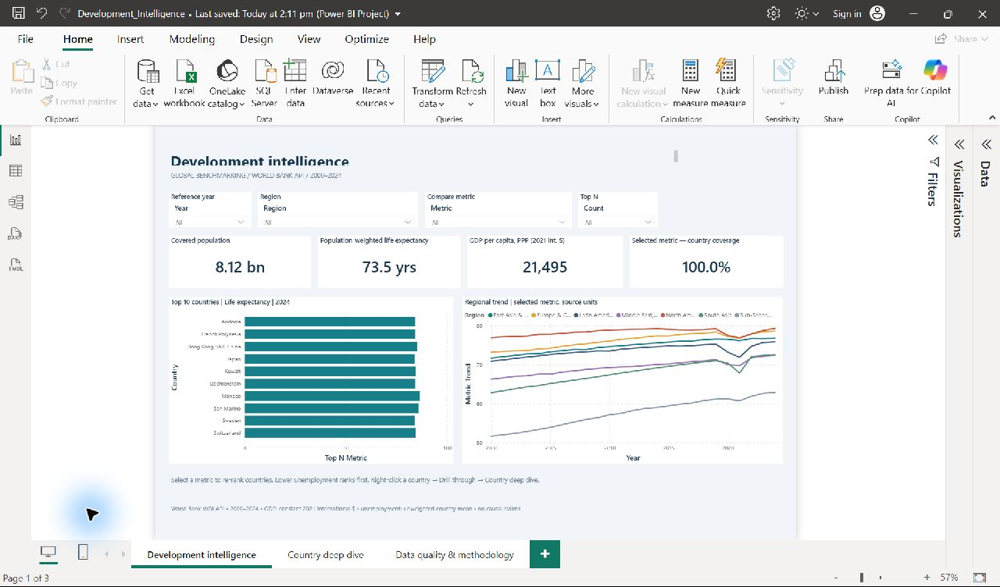
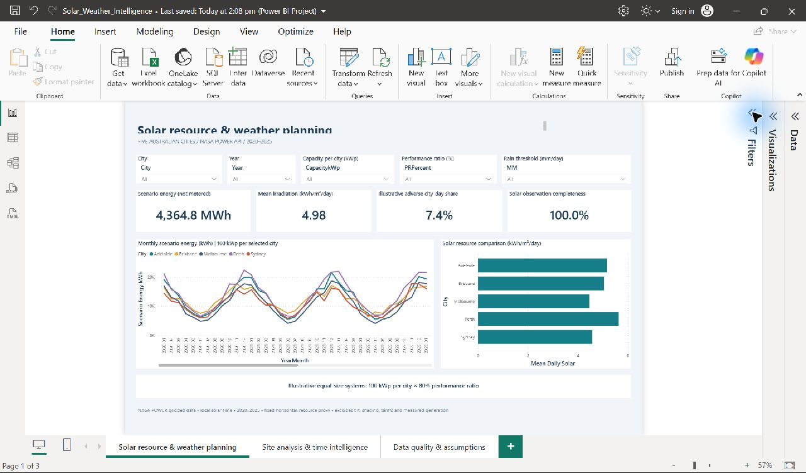
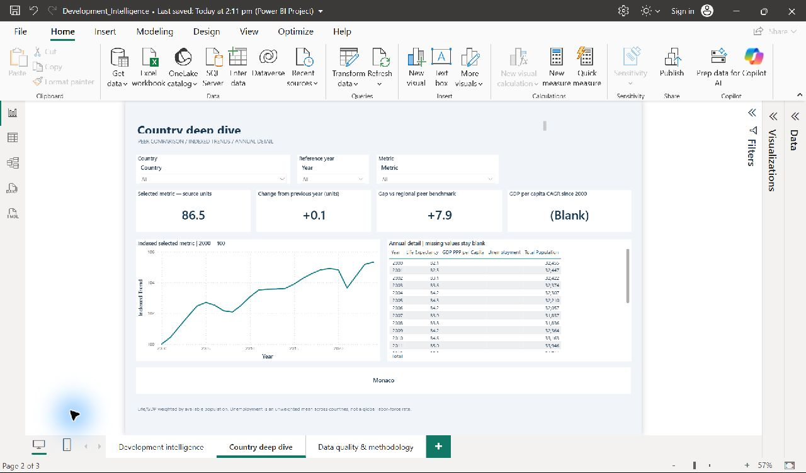
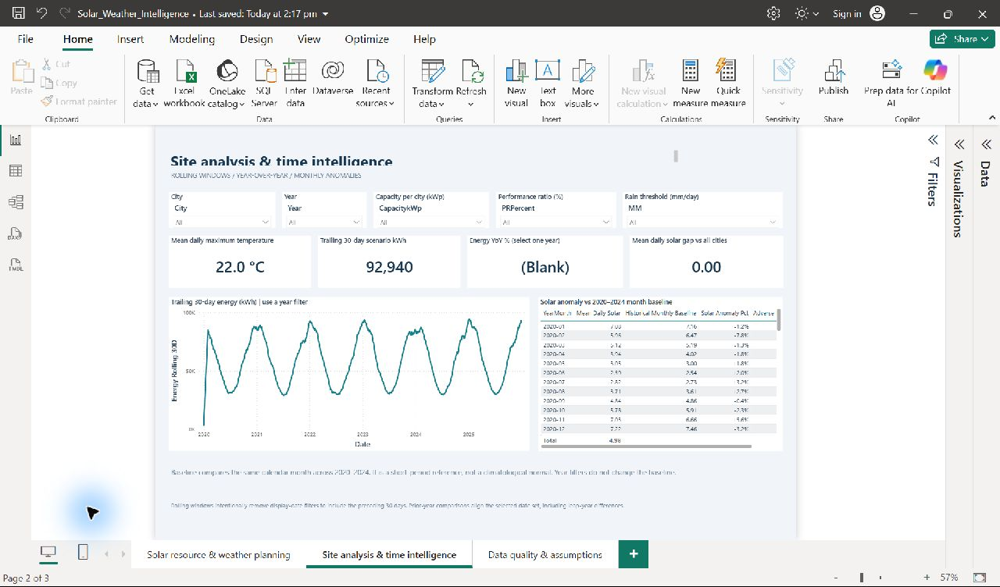
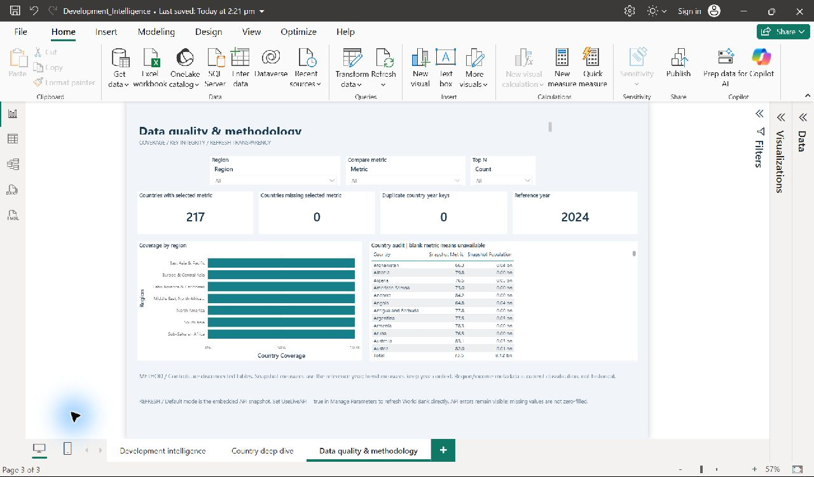
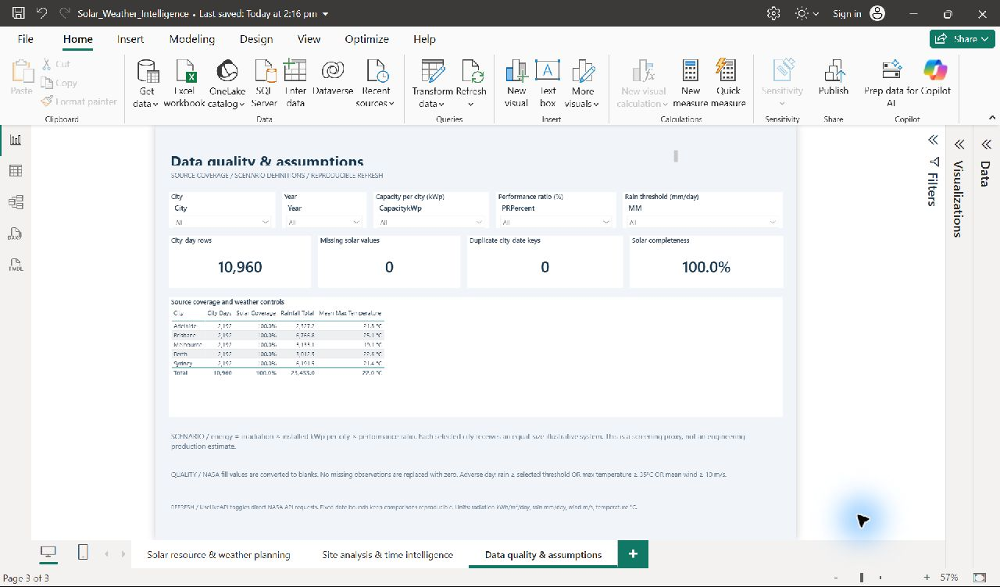
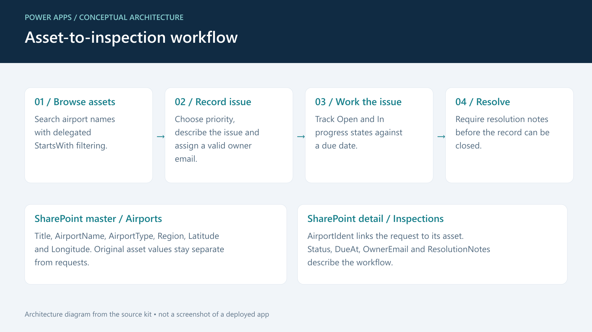
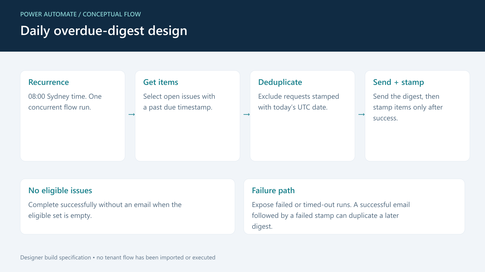

# Portfolio screenshots and video walkthroughs

Four short, silent, captioned MP4s are included. They use 1920×1080 frames, H.264 video at 24 fps and a silent AAC track. The Power BI videos are screenshot walkthroughs rather than continuous screen recordings. The Power Platform videos are source-kit explainers with conceptual diagrams and abbreviated logic illustrations; they do not show a deployed native app or a cloud-flow run.

**[Download the complete media pack](https://github.com/mmalik2194/powerbi-api-portfolio/releases/download/v1.2.0/Portfolio_Media_Pack.zip)**

| Video | Download | Content |
|---|---|---|
| Development Intelligence | [MP4](https://github.com/mmalik2194/powerbi-api-portfolio/releases/download/v1.2.0/development_walkthrough.mp4) | Executive report, native country drillthrough and data-quality controls |
| Solar Intelligence | [MP4](https://github.com/mmalik2194/powerbi-api-portfolio/releases/download/v1.2.0/solar_walkthrough.mp4) | Resource/scenario dashboard, time analysis and source-quality checks |
| Power Apps source kit | [MP4](https://github.com/mmalik2194/powerbi-api-portfolio/releases/download/v1.2.0/powerapps_source_walkthrough.mp4) | Asset/inspection architecture, validation logic and tenant implementation plan |
| Power Automate source kit | [MP4](https://github.com/mmalik2194/powerbi-api-portfolio/releases/download/v1.2.0/powerautomate_source_walkthrough.mp4) | Digest design, local reminder-selection logic and nine tested cases |

Each walkthrough is approximately 32 seconds. The exact metadata and decode checks are recorded in [media/media_manifest.json](media/media_manifest.json).

## Native Power BI screenshots

These are actual Desktop captures. No values have been replaced or fabricated. The walkthrough videos crop the authoring interface and frame the report for readability; full screenshots remain available below.

| Development | Solar |
|---|---|
|  |  |
|  |  |
|  |  |

The solar time-analysis screenshot intentionally leaves YoY blank with multiple years selected. Select a single year in the PBIX report to calculate that comparison. The screenshot shows rolling windows and monthly anomalies without implying an invalid multi-year YoY rate.

## Power Platform illustrations

The following are architecture illustrations made from the repository's implementation kits. They are not Power Apps Studio or Power Automate designer screenshots. Editable SVG versions are in [media/diagrams](media/diagrams).

The code illustrations are abbreviated for explanation. Use the complete [Power Fx implementation](03_PowerApps_Airport_Inspections/PowerFx.fx) and [executable reminder simulator](04_PowerAutomate_Inspection_Escalation/simulate.py) for implementation and local tests.

## Suggested portfolio use

- Use one video and two or three relevant images per portfolio project.
- Cover images are development_cover.png, solar_cover.png, powerapps_cover.png and automate_cover.png in media/diagrams/.
- Describe the Power BI projects as native-tested reports built on public data.
- Describe Power Apps and Power Automate as source/build kits with a locally tested simulator. Native tenant setup remains pending.
- These files include no voiceover, music, client identities or invented business outcomes. Optional narration can be recorded separately.

No media has been uploaded to a Fiverr or Upwork account.
