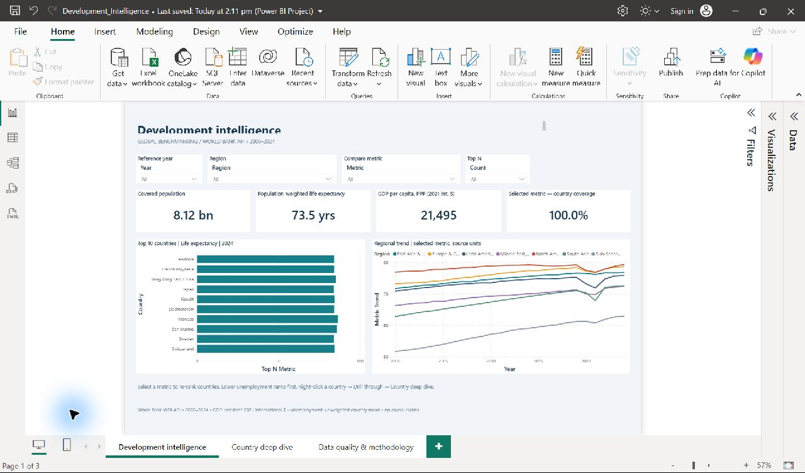
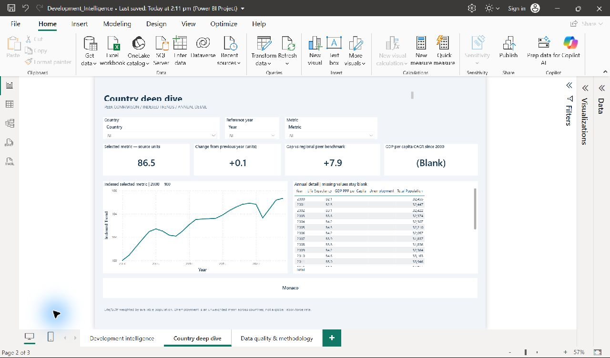
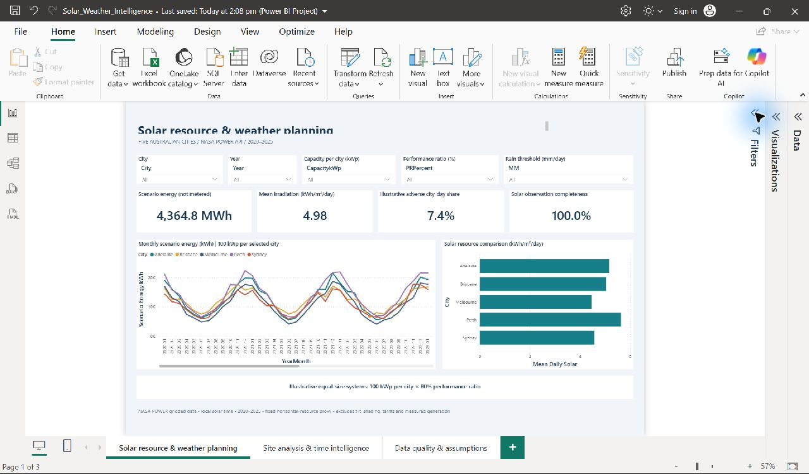

# Data Analytics & Automation Portfolio

Two advanced Power BI projects built from free public APIs, plus Power Apps and Power Automate source kits. The Power BI reports contain **six report pages and 56 DAX measures**, tested in Power BI Desktop.

**[Download both projects (ZIP)](https://github.com/mmalik2194/powerbi-api-portfolio/releases/download/v1.0.0/Advanced_PowerBI_API_Portfolio.zip)** · **[Development report (PBIX)](https://github.com/mmalik2194/powerbi-api-portfolio/releases/download/v1.0.0/Development_Intelligence.pbix)** · **[Solar report (PBIX)](https://github.com/mmalik2194/powerbi-api-portfolio/releases/download/v1.0.0/Solar_Weather_Intelligence.pbix)**

PBIX downloads include imported data. GitHub shows the screenshots and source code; open the reports in Power BI Desktop for interaction.

## Development Intelligence

World Bank API data for **217 economies, 2000–2024**. Includes population-weighted indicators, a disconnected metric selector, Top N ranking, regional peer comparisons, CAGR, indexed trends, country drillthrough and coverage diagnostics.



[Project guide](01_Global_Development_API/README.md) · [DAX measures](01_Global_Development_API/measures.dax) · [Power Query](01_Global_Development_API/PowerQuery)

### Native country drillthrough



## Solar Resource & Weather Intelligence

NASA POWER API data for **five Australian cities, 2020–2025**. Includes disconnected capacity/performance controls, rolling 30-day energy, YoY/YTD, monthly baselines and anomalies, site comparisons and data-quality diagnostics. Energy is an illustrative scenario, not metered generation.



[Project guide](02_Solar_Weather_API/README.md) · [DAX measures](02_Solar_Weather_API/measures.dax) · [Power Query](02_Solar_Weather_API/PowerQuery)

## Start here

1. Download a PBIX from the links above and open it in a recent Power BI Desktop.
2. Use the slicers and page tabs. For country details, right-click a country bar and choose **Drill through → Country deep dive**.
3. For solar YoY/YTD, select one year. Change capacity or performance ratio to test the scenario.
4. To inspect the editable source, clone this repository and open either `.pbip` file. Keep its Report and SemanticModel sibling folders together, then select Refresh.
5. To refresh directly from the public APIs, set `UseLiveAPI=true` under **Transform data → Manage Parameters** and apply. The default false setting uses the reproducible embedded snapshot.

## Power Platform source projects

| Project | Included code and assets | Status |
|---|---|---|
| [Airport inspection tracker — Power Apps + SharePoint](03_PowerApps_Airport_Inspections/README.md) | [Power Fx formulas](03_PowerApps_Airport_Inspections/PowerFx.fx), list schema, provisioning PowerShell, public airport master and synthetic requests | Buildable source kit; no native app or tenant deployment claimed |
| [Overdue inspection escalation — Power Automate](04_PowerAutomate_Inspection_Escalation/README.md) | [Flow build specification](04_PowerAutomate_Inspection_Escalation/flow_build_spec.json), [executable simulator](04_PowerAutomate_Inspection_Escalation/simulate.py), nine tests and synthetic requests | Designer specification and tested selection logic; not an importable exported solution |

**[Download the Power Platform source kits](https://github.com/mmalik2194/powerbi-api-portfolio/releases/download/v1.1.0/Power_Platform_Source_Kits.zip)**

The two projects form one workflow: select a public airport → create an issue with an owner and due date → record progress and resolution → identify overdue open issues for a daily coordinator digest. The public assets are real; inspection issues and SLA rules are demonstration data. Connection values are supplied by the deployer.

Run the automation tests without Microsoft credentials:

```bash
cd 04_PowerAutomate_Inspection_Escalation
python -m unittest test_simulate.py
python simulate.py
```

Additional Power Platform screenshots and demonstration videos will be prepared separately after native tenant setup. No messages have been sent by these projects.

## Technical evidence

- Star schemas with unique dimension keys and one-direction relationships.
- 30 development measures and 26 solar measures executed in the native engine.
- Independent numerical reconciliation, parameter-scaling checks and duplicate-key controls.
- A tested native country-drillthrough interaction.
- Actual Desktop screenshots, original API JSON, normalized CSV and provenance hashes.

[Validation details](VALIDATION.md) · [Numerical controls](validation_controls.json) · [Sources and hashes](sources.json)

## Data and interpretation

Data was retrieved on **1 November 2026** from the [World Bank API](https://datahelpdesk.worldbank.org/knowledgebase/articles/898581-api-basic-call-structures) and [NASA POWER API](https://power.larc.nasa.gov/docs/services/api/temporal/daily/). No API key is required. Source terms and methodology are linked in each project guide.

Native Desktop tests used the downloaded snapshot branches. The direct API endpoints were tested during ingestion; live refresh in Power BI Service and online publication have not been configured. World Bank comparisons are descriptive, unemployment is an unweighted country-rate mean, and solar output is a clearly defined screening scenario.

These are **personal demonstration projects using public data**. No client engagement, production deployment or measured commercial impact is claimed.
